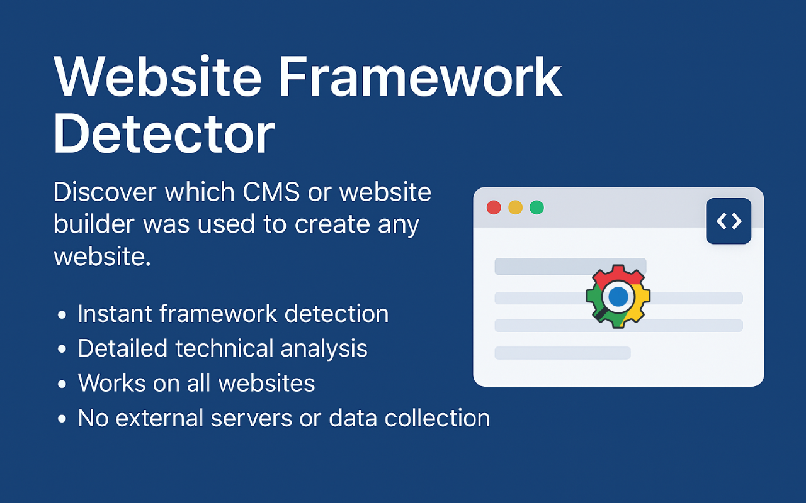
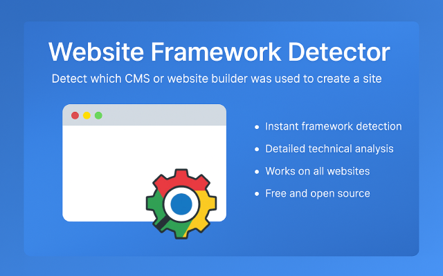

# Website Framework Detector

> Instantly reveal the CMS, website builder, and full tech stack behind any website — privately, in your browser, with zero tracking.

[](https://chromewebstore.google.com/detail/website-framework-detector/ebkogcpaeaofidbegiadlfcfhlnaccnn)
[](https://chromewebstore.google.com/detail/website-framework-detector/ebkogcpaeaofidbegiadlfcfhlnaccnn)
[](https://chromewebstore.google.com/detail/website-framework-detector/ebkogcpaeaofidbegiadlfcfhlnaccnn/reviews)
[](https://developer.chrome.com/docs/extensions/mv3/intro/)
[](LICENSE)
[](marketing/privacy.html)

🔗 **[Install from the Chrome Web Store](https://chromewebstore.google.com/detail/website-framework-detector/ebkogcpaeaofidbegiadlfcfhlnaccnn)** · **[Learn more](https://anupammondal.in/chrome-extension/website-framework-detector)**

Website Framework Detector is a lightweight Chrome extension that identifies which platform powers a site — **WordPress, WooCommerce, Shopify, Wix, Webflow, Squarespace, Joomla, Drupal, Magento** and more — along with its frontend libraries, theme, marketing/analytics tools, and key page-health facts. Everything runs **locally**: no account, no servers, no data collection.



---

## 🆕 What's new in v1.4

- **A bigger, app-style window (780×580).** Sidebar sections for Overview, Tech stack, Marketing, SEO health, Security and History, a confidence ring, a 0–100 health score, keyboard shortcuts and an "open full report" tab view.
- **Clickable history + CSV export, and Discoveries.** Reopen any past scan instantly, and collect the platforms you find.
- **More accurate on real sites.** A full audit fixed WordPress/Drupal sites showing as PrestaShop, WordPress sites with HubSpot forms showing as "HubSpot CMS", Django sites showing as Magento, Laravel sites showing as Rails, and more. Every fix has a regression test.
- **44 platforms** (up from 17). New: OpenCart, Shopware, Salesforce Commerce Cloud, TYPO3, Sitecore, AEM, Odoo, Weebly, GoDaddy, Tilda, Jimdo, Kajabi, Teachable, Substack, Notion, Docusaurus, GitBook and more.
- **Plugins & apps.** Every WordPress plugin the page loads (with versions), page builders, SEO plugins and Shopify apps.
- **Widgets & services.** Payments (Stripe, PayPal, Razorpay…), live chat, cookie consent, captcha, maps, video and monitoring tools.
- **Tracking IDs.** GA4, GTM, Google Ads and Meta Pixel IDs. Click a chip to copy the ID.
- **Site health.** Flags `noindex`, a robots.txt that blocks Google, mixed content, missing title/description/H1, end-of-life PHP and more.
- **Markdown report + "Report a wrong result"** button.

See the full [changelog](CHANGELOG.md) and the [roadmap](ROADMAP.md).

---

## Why this extension

Most "what is this site built with" tools either phone home, require an account, or quietly profile your browsing. This one doesn't. It is built around three principles:

- **Private by default** — detection happens entirely in your browser. Nothing is sent anywhere.
- **Lean by design** — only `activeTab`, `scripting`, and `storage`; **no host permissions, no browsing access**, and code runs **only when you click**, never silently on every page.
- **Honest results** — confidence scores reflect the actual signals found on the page, not a random number.

### How it compares

| | Framework Detector | Wappalyzer | BuiltWith | WhatRuns |
|---|:---:|:---:|:---:|:---:|
| 100% local, no servers | ✅ | ⚠️ (sends data) | ❌ | ⚠️ |
| No account required | ✅ | ✅ | ❌ | ⚠️ |
| Runs only on click (no passive scanning) | ✅ | ❌ | ❌ | ❌ |
| Open source | ✅ (GPLv3) | ⚠️ partial | ❌ | ❌ |
| Free, no paywall | ✅ | ⚠️ freemium | ⚠️ freemium | ✅ |
| Minimal permissions (no host/browsing access) | ✅ | ❌ | ❌ | ❌ |

---

## Features

- 🔎 **Platform detection (44)** — WordPress, WooCommerce, Shopify, Wix, Webflow, Squarespace, Joomla, Drupal, Magento, PrestaShop, BigCommerce, OpenCart, Shopware, Salesforce Commerce Cloud, Ghost, Blogger, HubSpot CMS, Framer, Craft CMS, Duda, TYPO3, Concrete CMS, Sitecore, Adobe Experience Manager, Odoo, Weebly, GoDaddy, Tilda, Jimdo, Strikingly, Hostinger, Kajabi, Teachable, Thinkific, Substack, Medium, Tumblr, Notion, Docusaurus, VitePress, MkDocs, GitBook, Sphinx, Mintlify.
- 🔌 **Plugins & apps** — all WordPress plugins visible on the page (with versions), page builders (Elementor, Divi, WPBakery, Bricks…), SEO plugins, and Shopify apps.
- 💳 **Widgets & services** — payments, live chat, cookie consent, captcha, maps, video, monitoring, email marketing, A/B testing.
- 🩺 **Site health** — noindex, robots.txt blocking, HTTPS/mixed content, title/description/H1, canonical, sitemap, end-of-life PHP.
- 🧩 **Tech stack** — React, Preact, Vue, Angular, Svelte, Solid, Qwik, Ember, Next.js, Nuxt, Remix, Gatsby, Astro, Hugo, Jekyll, Eleventy, jQuery, Tailwind, Bootstrap, Three.js, GSAP, Stripe, and more.
- 🎨 **Theme detection** — extracts the active theme/template where the platform exposes it.
- 📈 **Marketing & analytics tags** — Google Analytics/GA4, GTM, Meta Pixel, Hotjar, Clarity, Segment, Mixpanel, HubSpot, TikTok, LinkedIn, Pinterest, Intercom, and more.
- 🖥️ **Hosting, CDN & server** — Cloudflare, Vercel, Netlify, Fastly, CloudFront, GitHub Pages, Akamai, Nginx, Apache, plus back-end hints (PHP, ASP.NET) — read from response headers, no extra permissions.
- 🛡️ **Security headers** — at-a-glance HSTS, CSP, X-Frame-Options, X-Content-Type-Options, Referrer-Policy, Permissions-Policy.
- 🏷️ **Versions where exposed** — e.g. WordPress 6.5, jQuery 3.7, Angular 17.
- 📄 **Page info** — word count, reading time, image/alt audit, headings, links, scripts.
- 🧠 **"Why this result"** — expand to see exactly which signals matched.
- 🕘 **Detection history** — your recent scans, stored locally and clearable (never uploaded).
- 📊 **Real confidence scoring** — score reflects how many independent signals matched (never a random number).
- 🖼️ **Real brand logos** — instantly recognizable, bundled locally.
- ⚡ **Auto-detect on open** + **toolbar badge** + keyboard shortcut (`Alt+Shift+D`); one click to re-scan.
- 📋 **Copy & export** — copy a summary or download the full result as JSON.
- 🔗 **Share** — share the extension via the native share sheet (or copy link).
- 🌙 **Dark mode** — follows your system theme, with a manual toggle.
- 🔒 **Zero external assets** — all icons and logos are bundled; nothing is loaded from a CDN.

---

## Install

### From the Chrome Web Store (recommended)
**[➜ Install Website Framework Detector](https://chromewebstore.google.com/detail/website-framework-detector/ebkogcpaeaofidbegiadlfcfhlnaccnn)**, then pin the icon to your toolbar.

### Manual / developer install
1. Download or clone this repository.
2. Open `chrome://extensions`.
3. Enable **Developer mode** (top-right).
4. Click **Load unpacked** and select the project folder.

---

## Usage

1. Open any website.
2. Click the extension icon — detection runs **automatically**.

You'll see the detected platform, a confidence score, the theme, the tech stack, and any marketing/analytics tags present on the page. Use **Re-scan** to run again, **Copy**/**Export JSON** to grab the results, and the header toggle for dark mode.



---

## How it works

The extension inspects the live page using multiple independent signal types and scores the result:

- **DOM & meta signals** — `generator` meta tags, platform-specific classes, data attributes, asset paths (`/wp-content/`, `cdn.shopify.com`, …).
- **Script & stylesheet sources** — precise host/path matching (not loose substrings).
- **Page runtime globals** — probed safely in the page's own JavaScript context (e.g. `Shopify`, `wp`, `Webflow`, `React`) via a `MAIN`-world script, then passed back.
- **Scoring** — each match contributes to a confidence value; the platform with the strongest evidence wins.

Detection is **triggered on demand** from the popup using `chrome.scripting`, so no code runs on pages you don't ask about.

```
popup.html / popup.js     ← UI + triggers detection on click
  └─ chrome.scripting      ← injects detectors into the active tab (MAIN world)
       ├─ detectUtils       ← shared helpers (one temporary window.__wfd namespace)
       ├─ headerDetector    ← hosting/CDN, server, security headers (same-origin)
       ├─ frameworkDetector ← CMS / builder / e-commerce platform (signal table)
       ├─ themeDetector     ← active theme/template
       ├─ techStackDetector ← frameworks, libraries, plugins/apps, services
       ├─ siteInfoDetector  ← analytics tags + IDs, robots.txt, sitemap
       ├─ pageInfoDetector  ← SEO basics and page stats
       └─ collect           ← runs everything, builds site-health checks
  window.__wfd is deleted after the scan — nothing is left on the page.
```

---

## Privacy

This extension does **not** collect, store, or transmit any personal data or browsing history. All analysis is performed locally on the page you explicitly choose to scan. See the full [Privacy Policy](marketing/privacy.html).

---

## Development

This is a vanilla JavaScript Manifest V3 extension — no build step required.

```bash
git clone https://github.com/anupammo/site-platform-detector.git
cd site-platform-detector
# Load unpacked in chrome://extensions
```

**Project layout**

| File | Purpose |
|---|---|
| `manifest.json` | MV3 manifest (permissions, icons, popup) |
| `popup.html` / `popup.js` | Extension UI and result rendering |
| `detectUtils.js` | Shared helpers (asset snapshot, safe global lookup, soft fetch) |
| `frameworkDetector.js` | CMS / website-builder / e-commerce platforms (signal table) |
| `techStackDetector.js` | Frameworks, libraries, plugins & apps, widgets & services |
| `themeDetector.js` | Active theme / template extraction |
| `siteInfoDetector.js` | Analytics tags + tracking IDs, robots.txt, sitemap |
| `pageInfoDetector.js` | SEO basics and page stats |
| `headerDetector.js` | Hosting/CDN, server, security headers (same-origin fetch) |
| `collect.js` | Runs all detectors, builds site-health checks |
| `tests/` | Fixture pages + test runners (not shipped in the store package) |
| `background.js` | Service worker (lifecycle, install page) |
| `icons/brands/` | Bundled brand logos (recolored Simple Icons, CC0) |

### Project docs
- [Changelog](CHANGELOG.md)
- [Growth strategy (Chrome Web Store, Month 3+)](docs/growth-strategy.md)
- [SEO & ASO playbook](marketing/seo.md)

### Running the tests

```bash
npm install          # installs Playwright (dev only)
npx playwright install chromium
npm test             # 33 fixture pages through the real detector files
npm run test:e2e     # loads the extension and checks the popup end to end
```

### Adding a new platform or technology
1. Platforms: add an entry to the `P` table in `frameworkDetector.js` — signals are `gen` (generator meta), `js` (runtime global), `dom` (selector), `asset` (script/link URL), `hdr` (response header), `cookie`, `host`.
2. Technologies: add a rule to `techStackDetector.js` with a precise test (exact host/path or a runtime global — no loose substrings).
3. Add a realistic fixture to `tests/fixtures.js` — including a "must not detect" case if the signal could collide with another platform.
4. Run `npm test`.

---

## Roadmap

See [ROADMAP.md](ROADMAP.md) for the plan from ~250 to 500+ users (v1.4 → v1.6).

---

## Contributing

Issues and pull requests are welcome. Please include a sample URL or HTML fixture when reporting a detection miss so it can be added to the regression set.

## License

[GNU GPL v3](LICENSE) © [Anupam Mondal](https://anupammondal.in)

## Links & Support

- 🧩 **Chrome Web Store:** [Website Framework Detector](https://chromewebstore.google.com/detail/website-framework-detector/ebkogcpaeaofidbegiadlfcfhlnaccnn)
- 🌐 **Product page:** [anupammondal.in/chrome-extension/website-framework-detector](https://anupammondal.in/chrome-extension/website-framework-detector)
- ✍️ **Leave a review:** [Rate it on the Web Store](https://chromewebstore.google.com/detail/website-framework-detector/ebkogcpaeaofidbegiadlfcfhlnaccnn/reviews)
- 📧 **Questions / feature requests:** **a09051985@gmail.com** **anupam.wd@gmail.com**
